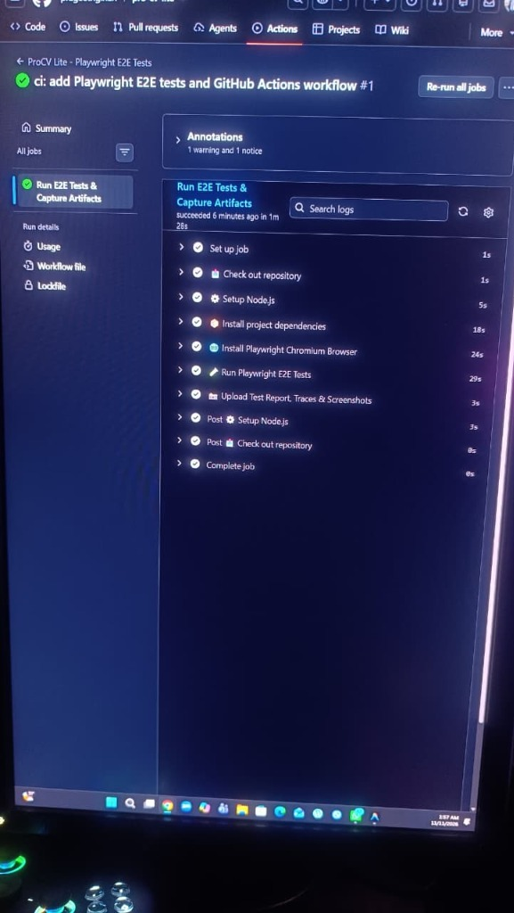

<div align="center">
  <h1>ProCV Lite</h1>
  <p>AI-Powered Next-Gen Resume Builder with Automated QA & CI/CD</p>
</div>

<p align="center">
  <a href="https://react.dev"></a>
  <a href="https://vitejs.dev/"></a>
  <a href="https://firebase.google.com/"></a>
  <a href="https://tailwindcss.com/"></a>
  <a href="https://deepmind.google/technologies/gemini/"></a>
  <a href="https://www.tensorflow.org/js"></a>
  <a href="https://playwright.dev/"></a>
  <a href="https://github.com/features/actions"></a>
</p>

<p align="center">
  <a href="https://github.com/prageethgihan/pro-cv-lite/actions/workflows/playwright.yml">
    
  </a>
</p>

<br/>

## 🌟 About ProCV Lite

**ProCV Lite** is an advanced, intelligent resume building platform designed for students and professionals. Built as a comprehensive academic software engineering project, it moves beyond traditional word processors by offering an AI-assisted, highly dynamic, and beautifully designed web application to craft the perfect professional narrative. 

Whether you're targeting corporate roles, creative positions, or academic placements, ProCV Lite provides the intelligence, aesthetics, and engineering rigor to make your application stand out.

---

## 🚀 Key Features

<table width="100%">
  <tr>
    <td width="50%" valign="top">
      <h3>🤖 AI & Machine Learning</h3>
      <ul>
        <li><b>AI Text Enhancement:</b> Instant grammar fixes and professional tone improvements powered by <i>Google Gemini AI</i>.</li>
        <li><b>Smart Background Removal:</b> On-device ML using <i>U2-Net</i> for flawless profile picture extraction without servers.</li>
        <li><b>Auto Face Cropping:</b> Uses <i>face-api.js</i> to perfectly align and center your face in the avatar.</li>
        <li><b>AI Cover Letters:</b> Generate tailored, ATS-friendly cover letters instantly using real job details.</li>
      </ul>
    </td>
    <td width="50%" valign="top">
      <h3>🎨 Premium UI/UX</h3>
      <ul>
        <li><b>Glassmorphism Design:</b> State-of-the-art dark/light SaaS aesthetic with frosted glass effects.</li>
        <li><b>Dynamic Theming:</b> Curated color palettes with automatic theme extraction from your profile photo!</li>
        <li><b>Real-time Preview:</b> See your CV update instantly in a beautifully rendered A4 mock-up modal.</li>
        <li><b>Responsive Flow:</b> Seamless experience across desktops, tablets, and mobile devices.</li>
      </ul>
    </td>
  </tr>
</table>

### ⚙️ Powerful Core Functionality
- **High-Fidelity PDF Export:** Pixel-perfect CV rendering utilizing `html2canvas` and `jsPDF`.
- **Cloud Synchronization:** Secure, real-time autosave and authentication via Firebase Firestore.
- **Analytics & Insights:** Track the status of your applications and view generated AI insights dynamically.
- **Instant Sharing:** Generate public URLs and QR codes to share your profile effortlessly.

---

## 🧪 Quality Assurance & Automated Testing (QA)

To ensure enterprise-grade reliability, UI stability, and prevent regressions, **ProCV Lite incorporates an automated End-to-End (E2E) testing suite powered by Playwright and an automated CI/CD pipeline via GitHub Actions.**

### 🎯 Test Scope & Coverage
The automated test suite runs **17 comprehensive test cases** spanning multiple critical operational vectors:

| Test Suite | Scope & Functional Verifications | Execution Status |
| :--- | :--- | :---: |
| **Authentication & Smoke**<br/>`smoke.spec.js` | • Landing page and brand identity rendering<br/>• Google OAuth trigger and Email/Password fields<br/>• Smooth switching between Login & Register modes | ✅ **Passed (100%)** |
| **Cross-Device & Responsive**<br/>`responsive.spec.js` | • Mobile viewports (iPhone 13 - 390x844): forms & buttons tap accessibility<br/>• Tablet viewports (iPad - 768x1024): responsive grid alignment | ✅ **Passed (100%)** |
| **Security Guards & Routing**<br/>`routing-and-public.spec.js` | • Unauthorized access guards for `/builder`, `/dashboard`, `/templates`, `/ai-writer`, etc.<br/>• Graceful fallback handling for non-existent public CV links | ✅ **Passed (100%)** |
| **Theme & State Persistence**<br/>`theme.spec.js` | • `localStorage` theme preference synchronization<br/>• Dynamic DOM `data-theme` attribute and Tailwind dark/light class binding | ✅ **Passed (100%)** |

### 📸 Test Evidence & Pipeline Execution

<table width="100%">
  <tr>
    <td width="50%" align="center">
      <b>Playwright Interactive UI Dashboard</b><br/>
      <sub>17/17 (100%) Tests Passing with Time-Travel DOM Snapshots</sub><br/><br/>
      
    </td>
    <td width="50%" align="center">
      <b>GitHub Actions CI/CD Pipeline</b><br/>
      <sub>Automated Cloud Runner executing E2E tests & caching artifacts in 1m 28s</sub><br/><br/>
      
    </td>
  </tr>
</table>

### 🔄 CI/CD Workflow Architecture
- **Continuous Integration (CI):** Every push or pull request to `main` automatically spins up a clean Ubuntu cloud instance via GitHub Actions.
- **Automated Verification:** Installs project dependencies, provisions the Chromium browser engine, runs the full test suite in parallel across workers, and captures visual traces.
- **Artifact Caching:** Generates and securely stores full HTML reports, network logs, and screenshots under GitHub Artifacts with 30-day retention.

---

## 🏗️ Architecture & Tech Stack

ProCV Lite is built using modern, robust technologies to ensure high performance, security, and scalability.

- **Frontend:** React 19, Vite, Tailwind CSS, Framer Motion, Recharts.
- **Backend & Database:** Firebase Authentication, Firestore (NoSQL Document Store), Firebase Storage.
- **AI / ML Pipeline:** Google Generative AI (Gemini), TensorFlow.js, Face-API.js, `@imgly/background-removal`.
- **State Management & Routing:** React Context API, React Router DOM.
- **Quality Assurance & Testing:** Playwright (Chromium E2E Automation), Playwright UI, Trace Viewer.
- **CI / CD Infrastructure:** GitHub Actions Cloud Automation Workflow.
- **Export Engine:** html2canvas, jsPDF.

---

## 💻 Local Setup & Installation

Get ProCV Lite running on your local machine in minutes!

```bash
# 1. Clone the repository
git clone https://github.com/prageethgihan/pro-cv-lite.git

# 2. Navigate into the directory
cd pro-cv-lite

# 3. Install dependencies
npm install

# 4. Set up environment variables
# Create a .env file and add your Firebase & Gemini API credentials
# (See .env.example if available)

# 5. Start the development server
npm run dev
```

### 🧪 Running QA & E2E Tests Locally

```bash
# Run all 17 E2E tests headlessly
npm run test:e2e

# Run tests in a live Google Chrome browser (Headed Mode)
npm run test:e2e:headed

# Open the interactive Playwright UI Dashboard with step-by-step visual debugging
npm run test:e2e:ui

# View the full graphical HTML test report with trace snapshots
npm run test:e2e:report
```

---

<div align="center">
  <p>Built with ❤️ by Prageeth Gihan</p>
</div>
